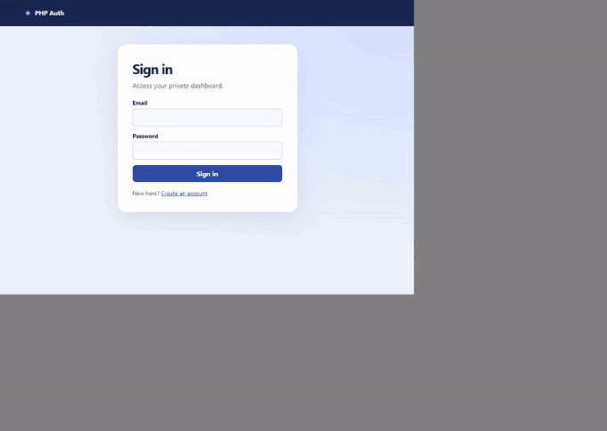
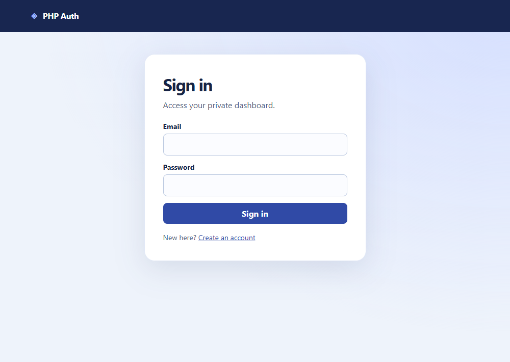
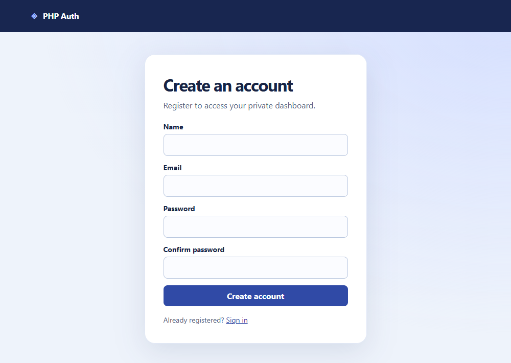
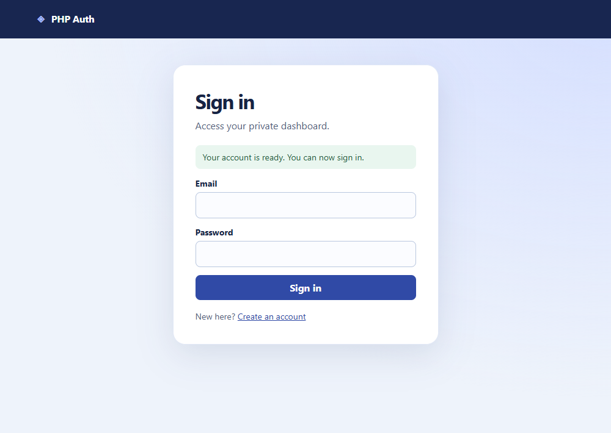
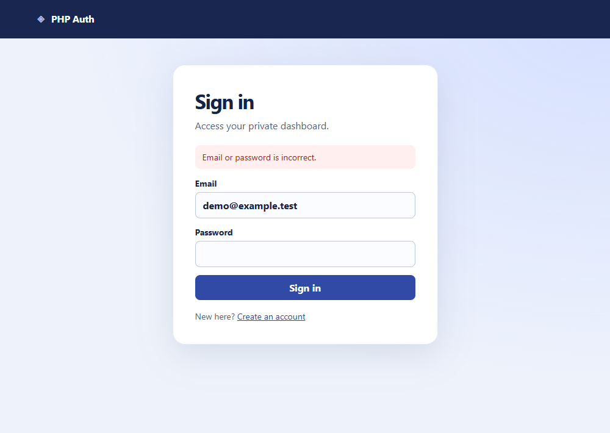
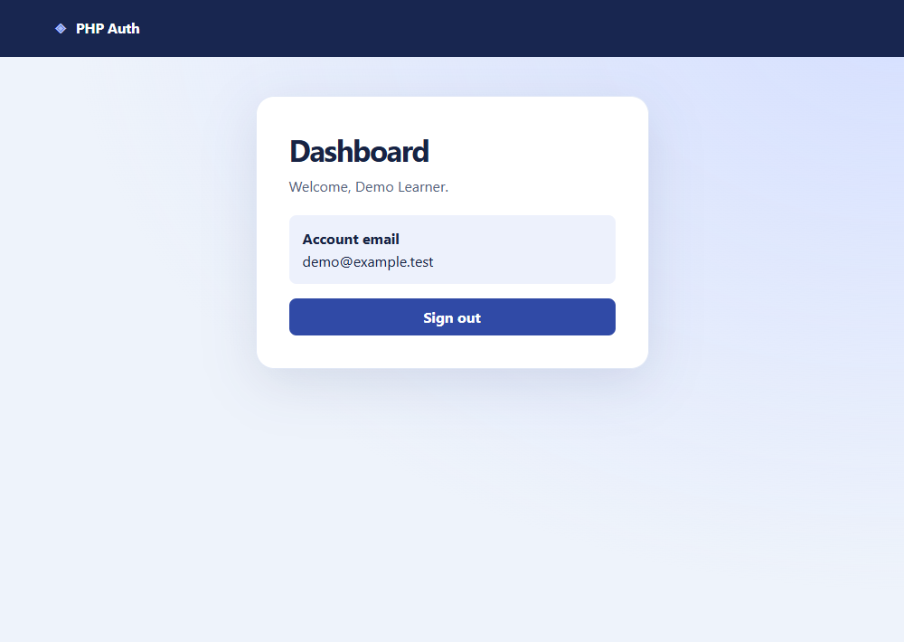
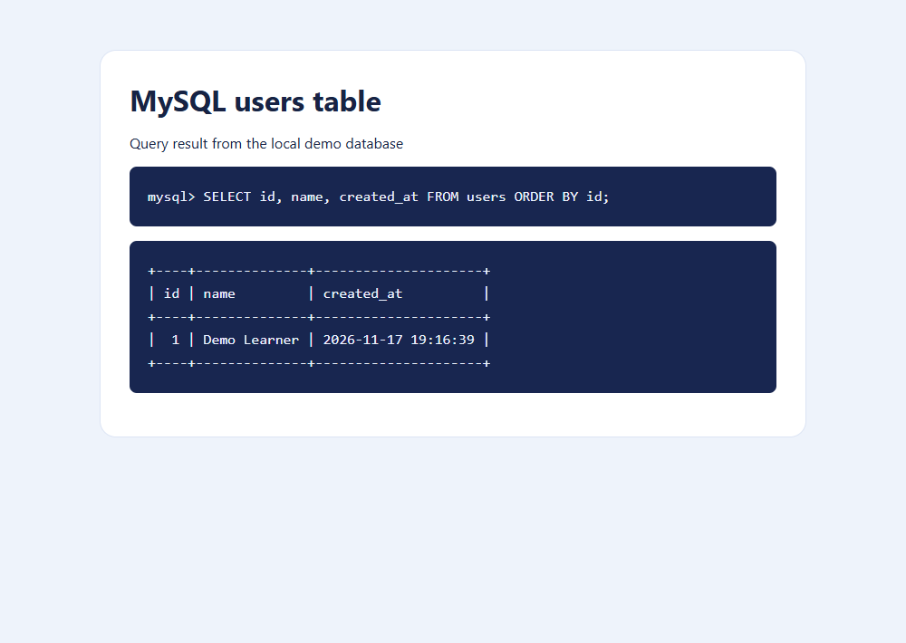
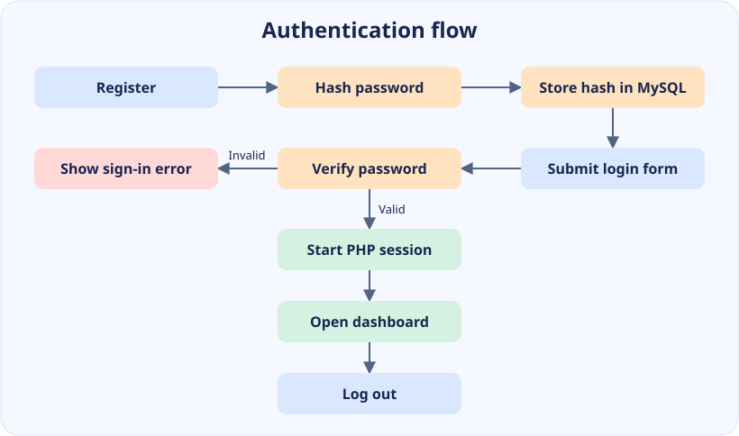
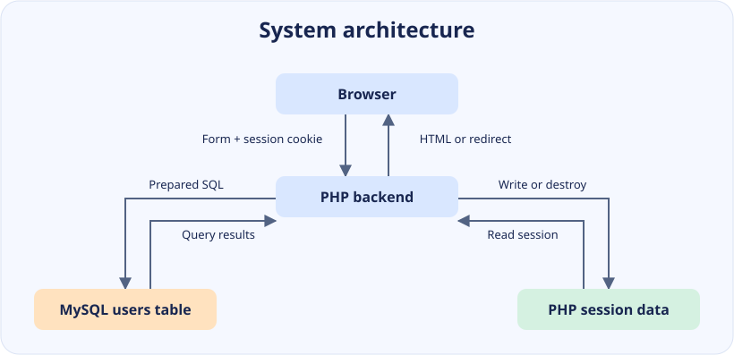

# PHP User Authentication System


A small Core PHP application for learning how registration, password verification, and session-protected pages work. The interface uses HTML and CSS, and PHP connects to MySQL with MySQLi.

## Project demonstration



[Watch the full MP4](docs/demo/demo.mp4)

The demo opens the site, registers a disposable account, tries an incorrect password, signs in successfully, views the protected dashboard, signs out, and revisits the dashboard URL to show the redirect to sign-in.

## Key features

- Create an account with email and password confirmation.
- Sign in and view a dashboard tied to the current session.
- Sign out and clear the session. Direct dashboard visits require sign-in.

## Application screenshots

### Sign-in

Enter the email and password for an existing account.



### Registration

Enter a name, email, and matching passwords to create an account.



### Successful registration

PHP redirects to sign-in and displays a confirmation after MySQL stores the account.



### Invalid sign-in

An incorrect password leaves the visitor on the sign-in page and displays an error.



### Protected dashboard

After PHP verifies the password, the session allows access to the dashboard.



### MySQL users table

This live query result shows the demo row with only its ID, name, and creation timestamp.



## Authentication flow



## System architecture



## Folder structure

```text
app/                  Session, MySQLi, and shared PHP templates
public/               Browser-facing PHP routes and CSS
docs/images/          Screenshots and diagrams
docs/demo/            MP4 recording and animated GIF
database.sql          MySQL users table
compose.yaml          Local PHP and MySQL services
Dockerfile            Apache/PHP image with MySQLi
```

## Installation and setup

### Docker Compose

1. Start Docker with Compose support.
2. From the project directory, run `docker compose up --build -d`.
3. Open `http://localhost:8080`. The first start creates the database and users table.
4. Run `docker compose down` when finished. The database volume persists across restarts.

### Existing PHP and MySQL

1. Enable MySQLi in PHP 8.4. Create a database and import `database.sql`.
2. Set `DB_HOST`, `DB_USER`, `DB_PASSWORD`, and `DB_NAME` in the PHP process environment. Use a database account with `SELECT` and `INSERT` access to `users`.
3. Run `php -S 127.0.0.1:8080 -t public` from the project directory and open `http://localhost:8080`.

## Security features

- `password_hash()` stores a hash, and `password_verify()` checks credentials.
- MySQLi prepared statements bind form data separately from SQL.
- The server validates form input and escapes dynamic HTML.
- POST forms use CSRF tokens. PHP regenerates the session ID after sign-in and destroys the session at logout.
- Session cookies use HttpOnly and SameSite=Lax, and use Secure when PHP serves the request over HTTPS.

## Test results

Verified in Chromium against PHP 8.4 and MySQL 8.4. PHP syntax checks also passed.

| Check | Observed result |
| --- | --- |
| Register a new demo account | Pass · Sign-in displays a confirmation |
| Register with the same email | Pass · Registration displays a duplicate email error |
| Sign in with an incorrect password | Pass · Sign-in displays a generic error |
| Sign in with the correct password | Pass · Dashboard displays the demo account |
| Sign out and reopen the dashboard URL | Pass · Browser redirects to sign-in |
| Submit login without a CSRF token | Pass · Server returns HTTP 403 |
| Request logout with GET | Pass · Server returns HTTP 405 |

## Learning outcomes

Follow a form submission into PHP, see how password hashes are stored and verified, and trace how a session cookie lets PHP protect a route across separate requests.
